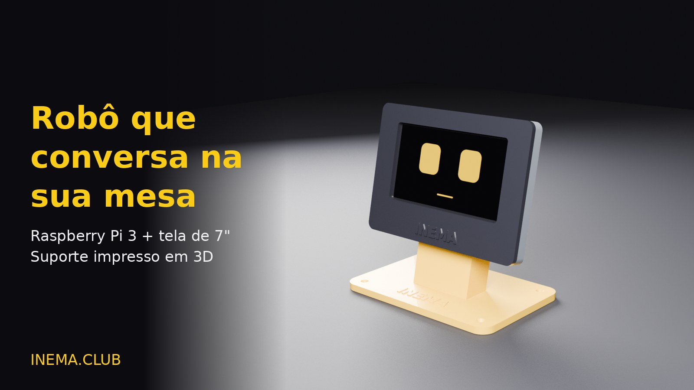

# Robô conversa

**🇧🇷 [Português](README.md) · 🇺🇸 [English](README.en.md) · 🇪🇸 [Español](README.es.md)**

**[Português](README.md) · [English](README.en.md) · [Español](README.es.md)**

## What it is

A desktop robot that listens and responds. A Raspberry Pi 3 sits behind the official 7-inch screen, in a 3D-printed stand that attaches to the desk. An animated face (yellow eyes and mouth) runs on the screen. You tap, speak, and the Pi sends your voice to your Jarvis server, plays the response, and moves its mouth in sync. The stand works with the Pi in a case and without a case.

**Honest status:** the 3D design and software have been checked on a computer (geometric checks and 4 automated tests with a fake Jarvis). Nothing has been printed, sliced, or connected to a real screen or microphone. The `/conversa` route does not yet exist in anyone’s Jarvis: the contract is in the guide.

## Guide and downloads

**https://linnoff88-dev.github.io/arckhe-/guia/en/**

Includes a render of the actual model, an interactive 3D model, dimensions, a bill of materials, STL, a ZIP of the parts, a ZIP of the software, and step-by-step instructions for printing, assembly, and software.

## The process, from start to finish

Who does what: 🧠 session with Nei · ⚙️ script · 🤖 `claude -p`.

1. 🧠 Decide on the screen, Pi, and how to use it (with/without a case). Dimensions and limits are in `cad/gerar.py` (parameters at the top).
2. ⚙️ Generate the parts and run verification: `../robos-impressos/.venv/bin/python cad/gerar.py` (writes to `estudo/`: STL, GLB, `verificacao.json`, `partes-mundo/`, `partes-explodida/`). Stops at the first failed check.
3. ⚙️ Quick preview of the parts: `blender -b -P scripts/previa.py -- estudo/partes-mundo estudo/previa`.
4. ⚙️ Face preview: `chromium --headless=new --screenshot=estudo/rosto-<estado>.png "file://$PWD/software/rosto/index.html?estado=<estado>"`; assemble `estudo/rosto-estados.png` (contact sheet of 5 states).
5. ⚙️ Final renders (Blender, CPU, ~4 min), using the render queue: `~/projetos/wifi/scripts/fila-vaga render robo-conversa -- env AMOSTRAS=320 blender -b -P scripts/render_guia.py -- estudo estudo/renders`; copy to `guia/assets/r-*.jpg`.
6. ⚙️ Banners from the actual render: `python3 scripts/banners.py` (no AI artwork: the robot has not been printed yet).
7. 🧠 Software: `python3 software/testes/test_ponte.py` (4 tests; starts a fake Jarvis, checks states, token, mouth, and server failure).
8. 🧠 Copy STL, GLB, and `verificacao.json` to `guia/downloads/` and rebuild both ZIPs (parts and software).
9. 🧠 Write the PT guide (`python3 scripts/monta_guia.py` → `guia/index.html`); ⚙️ translate to EN/ES: `python3 ~/projetos/wifi/scripts/traduz-pagina-codex.py html --base guia --pages index.html --langs en es --site-url https://linnoff88-dev.github.io/arckhe-/guia/en/` and then `python3 scripts/pos_guia.py`.
10. 🤖 Independent guide reviewer; check at 360 px and 1280 px over local HTTP.
11. 🧠 Commit and push (author linnoff88-dev); GitHub Pages publishes automatically. Push over SSH (the HTTPS token does not have the `workflow` scope).
12. 🧠 Portal (ARCKHÉ AI) and ARCKHÉ.ROBOT topic; the guide video will be added later at the `<!-- VIDEO -->` marker.
13. 🧠 Compact version (2.4″ GPIO screen, USB microphone): `../robos-impressos/.venv/bin/python cad/gerar_compacta.py` (writes `estudo/compacta/`); small-screen face: `python3 software/testes/test_rosto_fb.py` (7 tests) and `python3 software/rosto/rosto_fb.py --png <state> x.png`.
14. 🧠 Pending: print, measure (the 2.4″ screen uses TYPICAL dimensions), and assemble; expose `/conversa` in Jarvis; real test with a microphone and speaker.

## Files

- `cad/gerar.py`: generates the 7 parts of the large version (7″ screen, with a microphone pocket and a speaker box), the assembly, and the checks.
- `cad/gerar_compacta.py`: compact version (Pi 3 + 2.4″ screen + USB microphone): 3 parts and checks.
- `software/rosto/`: animated face (HTML). `software/ponte/robo.py`: Pi bridge (standard library only). `software/ponte/jarvis_falso.py`: test server.
- `guia/`: PT/EN/ES page, images, and downloads.
- `referencias/dimensoes.md`: where each dimension comes from.
