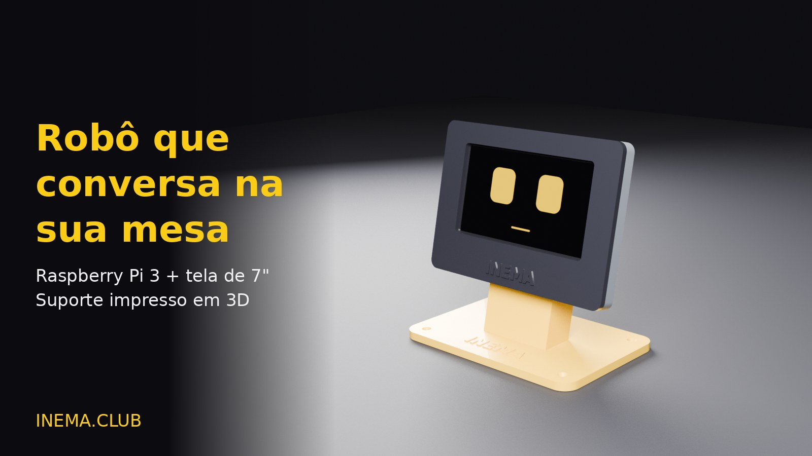

# Robô conversa

**🇧🇷 [Português](README.md) · 🇺🇸 [English](README.en.md) · 🇪🇸 [Español](README.es.md)**

**[Português](README.md) · [English](README.en.md) · [Español](README.es.md)**

## Qué es

Un robot de escritorio que escucha y responde. Una Raspberry Pi 3 se encuentra detrás de la pantalla oficial de 7 pulgadas, en un soporte impreso en 3D que se sujeta al escritorio. En la pantalla se muestra un rostro animado (ojos y boca amarillos). Lo tocas, hablas y la Pi envía tu voz a tu servidor Jarvis, reproduce la respuesta y mueve la boca al ritmo de esta. El soporte sirve para la Pi con caja y para la Pi sin caja.

**Estado real:** el diseño 3D y el software se verificaron en la computadora (comprobaciones geométricas y 4 pruebas automáticas con un Jarvis falso). No se imprimió ni laminó nada, ni se conectó a una pantalla o a un micrófono reales. La ruta `/conversa` todavía no existe en ningún Jarvis: el contrato está en la guía.

## Guía y descargas

**https://inematds.github.io/robo-conversa/guia/es/**

Incluye un render del modelo real, un modelo 3D giratorio, medidas, lista de materiales, STL, ZIP de las piezas, ZIP del software, instrucciones paso a paso para imprimir, ensamblar y usar el software.

## El proceso, de principio a fin

Quién lo hace: 🧠 sesión con Nei · ⚙️ script · 🤖 `claude -p`.

1. 🧠 Decidir la pantalla, la Pi y cómo usarla (con/sin caja). Medidas y límites en `cad/gerar.py` (parámetros al inicio).
2. ⚙️ Generar las piezas y la verificación: `../robos-impressos/.venv/bin/python cad/gerar.py` (guarda en `estudo/`: STL, GLB, `verificacao.json`, `partes-mundo/`, `partes-explodida/`). Se detiene ante la primera comprobación que falla.
3. ⚙️ Vista previa rápida de las piezas: `blender -b -P scripts/previa.py -- estudo/partes-mundo estudo/previa`.
4. ⚙️ Vista previa del rostro: `chromium --headless=new --screenshot=estudo/rosto-<estado>.png "file://$PWD/software/rosto/index.html?estado=<estado>"`; crear `estudo/rosto-estados.png` (composición de 5 estados).
5. ⚙️ Renders finales (Blender, CPU, ~4 min), mediante la cola de renderizado: `~/projetos/wifi/scripts/fila-vaga render robo-conversa -- env AMOSTRAS=320 blender -b -P scripts/render_guia.py -- estudo estudo/renders`; copiar a `guia/assets/r-*.jpg`.
6. ⚙️ Banners a partir del render real: `python3 scripts/banners.py` (sin arte de IA: el robot todavía no se imprimió).
7. 🧠 Software: `python3 software/testes/test_ponte.py` (4 pruebas; inicia un Jarvis falso, comprueba estados, token, boca y caída del servidor).
8. 🧠 Copiar STL, GLB y `verificacao.json` a `guia/downloads/` y volver a crear los dos ZIP (piezas y software).
9. 🧠 Escribir la guía en PT (`python3 scripts/monta_guia.py` → `guia/index.html`); ⚙️ traducir a EN/ES: `python3 ~/projetos/wifi/scripts/traduz-pagina-codex.py html --base guia --pages index.html --langs en es --site-url https://inematds.github.io/robo-conversa/guia/es/` y luego `python3 scripts/pos_guia.py`.
10. 🤖 Revisor independiente de la guía; comprobar 360 px y 1280 px por HTTP local.
11. 🧠 Commit y push (autor inematds); GitHub Pages publica automáticamente. Push por SSH (el token HTTPS no tiene el alcance `workflow`).
12. 🧠 Portal (inema.club) y tema INEMA.ROBOT; el video de la guía se agrega después en la marca `<!-- VIDEO -->`.
13. 🧠 Versión compacta (pantalla de 2,4″ por GPIO, micrófono USB): `../robos-impressos/.venv/bin/python cad/gerar_compacta.py` (guarda en `estudo/compacta/`); rostro en la pantalla pequeña: `python3 software/testes/test_rosto_fb.py` (7 pruebas) y `python3 software/rosto/rosto_fb.py --png <estado> x.png`.
14. 🧠 Pendiente: imprimir, medir (la pantalla de 2,4″ usa medidas TÍPICAS) y ensamblar; habilitar `/conversa` en Jarvis; prueba real con micrófono y altavoz.

## Archivos

- `cad/gerar.py`: genera las 7 piezas de la versión grande (pantalla de 7″, con bolsillo de micrófono y caja de altavoz), el ensamblaje y las comprobaciones.
- `cad/gerar_compacta.py`: versión compacta (Pi 3 + pantalla de 2,4″ + micrófono USB): 3 piezas y comprobaciones.
- `software/rosto/`: rostro animado (HTML). `software/ponte/robo.py`: puente de la Pi (solo biblioteca estándar). `software/ponte/jarvis_falso.py`: servidor de prueba.
- `guia/`: página PT/EN/ES, imágenes y descargas.
- `referencias/dimensoes.md`: de dónde proviene cada medida.
