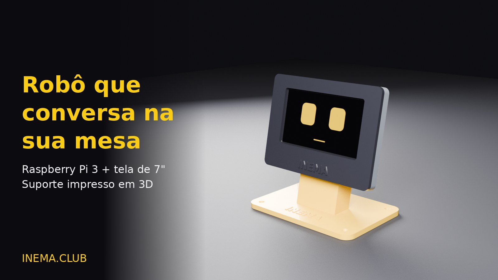

# RobêƒÂ´ conversa

  
  
<strong>Arckhé AI</strong>

**ê°Å¸â€¡Â§ê°Å¸â€¡Â· [PortuguêƒÂªs](README.md) ê‚· ê°Å¸â€¡Âºê°Å¸â€¡Â¸ [English](README.en.md) ê‚· ê°Å¸â€¡Âªê°Å¸â€¡Â¸ [EspaêƒÂ±ol](README.es.md)**

## O que êƒÂ©

Um robêƒÂ´ de mesa que ouve e responde. Um Raspberry Pi 3 fica atrêƒÂ¡s da tela oficial de 7 polegadas, num suporte impresso em 3D que se prende na mesa. Na tela roda um rosto animado (olhos e boca amarelos). VocêƒÂª toca, fala, e o Pi manda a sua voz ao seu servidor Jarvis, toca a resposta e mexe a boca no ritmo dela. O suporte serve para o Pi com caixa e para o Pi sem caixa.

**Estado honesto:** o desenho 3D e o software foram verificados no computador (checagens geomêƒÂ©tricas e 4 testes automêƒÂ¡ticos com um Jarvis de mentira). Nada foi impresso, fatiado nem ligado numa tela ou microfone reais. A rota `/conversa` ainda nêƒÂ£o existe no Jarvis de ninguêƒÂ©m: o contrato estêƒÂ¡ no guia.

## Guia e downloads

**https://linnoff88-dev.github.io/arckhe-/guia/**

Tem render do modelo real, modelo 3D girêƒÂ¡vel, medidas, lista de materiais, STL, ZIP das peêƒÂ§as, ZIP do software, passo a passo de impressêƒÂ£o, montagem e software.

## O processo, do inêƒÂ­cio ao fim

Quem faz: ê°Å¸Â§Â  sessêƒÂ£o com o Nei ê‚· ê¢Å¡â„¢ê¯Â¸Â script ê‚· ê°Å¸Â¤â€“ `claude -p`.

1. ê°Å¸Â§Â  Decidir tela, Pi e como usar (com/sem caixa). Medidas e limites em `cad/gerar.py` (parêƒÂ¢metros no topo).
2. ê¢Å¡â„¢ê¯Â¸Â Gerar as peêƒÂ§as e a verificaêƒÂ§êƒÂ£o: `../robos-impressos/.venv/bin/python cad/gerar.py` (grava `estudo/`: STL, GLB, `verificacao.json`, `partes-mundo/`, `partes-explodida/`). Para na primeira checagem que falhar.
3. ê¢Å¡â„¢ê¯Â¸Â PrêƒÂ©via rêƒÂ¡pida das peêƒÂ§as: `blender -b -P scripts/previa.py -- estudo/partes-mundo estudo/previa`.
4. ê¢Å¡â„¢ê¯Â¸Â PrêƒÂ©via do rosto: `chromium --headless=new --screenshot=estudo/rosto-<estado>.png "file://$PWD/software/rosto/index.html?estado=<estado>"`; montar `estudo/rosto-estados.png` (contato de 5 estados).
5. ê¢Å¡â„¢ê¯Â¸Â Renders finais (Blender, CPU, ~4 min), pela vaga de render: `~/projetos/wifi/scripts/fila-vaga render robo-conversa -- env AMOSTRAS=320 blender -b -P scripts/render_guia.py -- estudo estudo/renders`; copiar para `guia/assets/r-*.jpg`.
6. ê¢Å¡â„¢ê¯Â¸Â Banners a partir do render real: `python3 scripts/banners.py` (sem arte de IA: o robêƒÂ´ ainda nêƒÂ£o foi impresso).
7. ê°Å¸Â§Â  Software: `python3 software/testes/test_ponte.py` (4 testes; sobe Jarvis falso, confere estados, token, boca e queda do servidor).
8. ê°Å¸Â§Â  Copiar STL, GLB e `verificacao.json` para `guia/downloads/` e refazer os dois ZIP (peêƒÂ§as e software).
9. ê°Å¸Â§Â  Escrever o guia PT (`python3 scripts/monta_guia.py` ê¢â€ â€™ `guia/index.html`); ê¢Å¡â„¢ê¯Â¸Â traduzir para EN/ES: `python3 ~/projetos/wifi/scripts/traduz-pagina-codex.py html --base guia --pages index.html --langs en es --site-url https://linnoff88-dev.github.io/arckhe-/guia/` e depois `python3 scripts/pos_guia.py`.
10. ê°Å¸Â¤â€“ Revisor independente do guia; conferir 360 px e 1280 px por HTTP local.
11. ê°Å¸Â§Â  Commit e push (autor linnoff88-dev); o GitHub Pages publica sozinho. Push pelo SSH (o token HTTPS nêƒÂ£o tem escopo `workflow`).
12. ê°Å¸Â§Â  Portal (ARCKHÉ AI) e têƒÂ³pico ARCKHÉ.ROBOT; vêƒÂ­deo do guia entra depois na marca `<!-- VIDEO -->`.
13. ê°Å¸Â§Â  VersêƒÂ£o compacta (tela de 2,4ê¢â‚¬Â³ no GPIO, microfone USB): `../robos-impressos/.venv/bin/python cad/gerar_compacta.py` (grava `estudo/compacta/`); rosto na tela pequena: `python3 software/testes/test_rosto_fb.py` (7 testes) e `python3 software/rosto/rosto_fb.py --png <estado> x.png`.
14. ê°Å¸Â§Â  Pendente: imprimir, medir (a tela de 2,4ê¢â‚¬Â³ estêƒÂ¡ com medidas TêƒÂPICAS) e montar; expor `/conversa` no Jarvis; teste real com microfone e alto-falante.

## Arquivos

- `cad/gerar.py`: gera as 7 peêƒÂ§as da versêƒÂ£o grande (tela de 7ê¢â‚¬Â³, com bolso de microfone e caixa de alto-falante), a montagem e as checagens.
- `cad/gerar_compacta.py`: versêƒÂ£o compacta (Pi 3 + tela de 2,4ê¢â‚¬Â³ + microfone USB): 3 peêƒÂ§as e checagens.
- `software/rosto/`: rosto animado (HTML) e `rosto_fb.py` (rosto direto no framebuffer de telas pequenas). `software/ponte/robo.py`: ponte do Pi (sêƒÂ³ biblioteca padrêƒÂ£o). `software/ponte/jarvis_falso.py`: servidor de teste.
- `guia/`: pêƒÂ¡gina PT/EN/ES, imagens e downloads.
- `referencias/dimensoes.md`: de onde vem cada medida.

---

  
  
<strong>Arckhé AI</strong>

